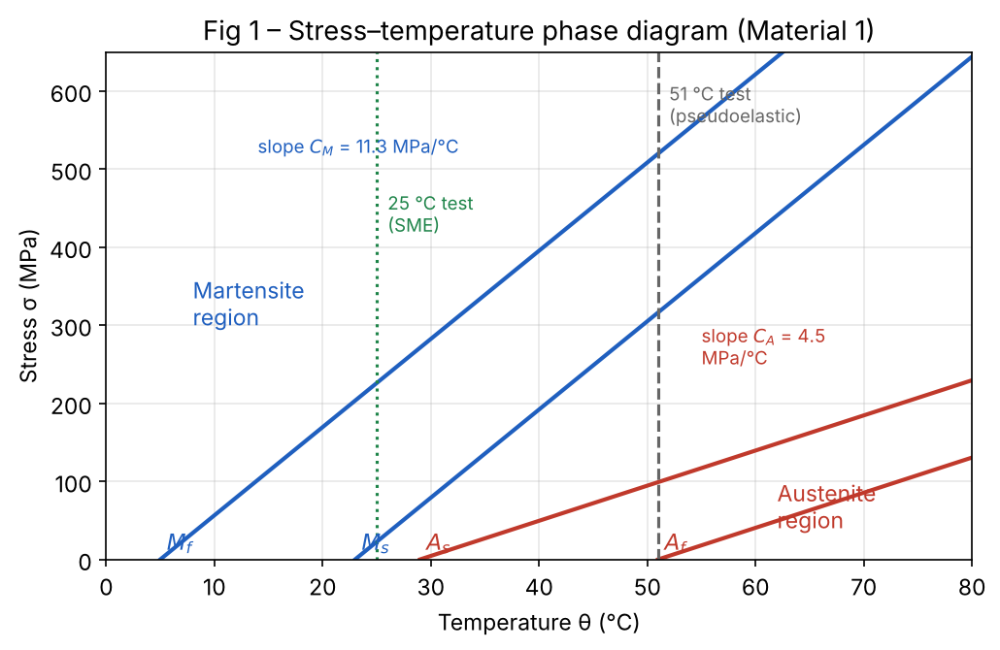
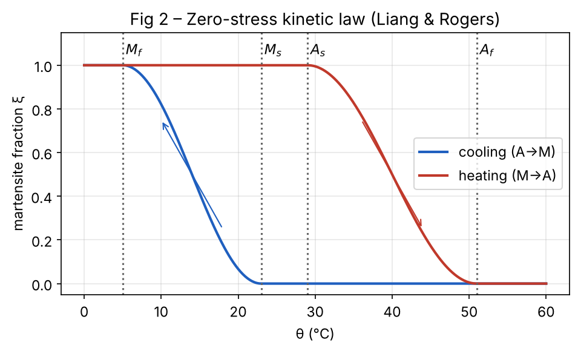
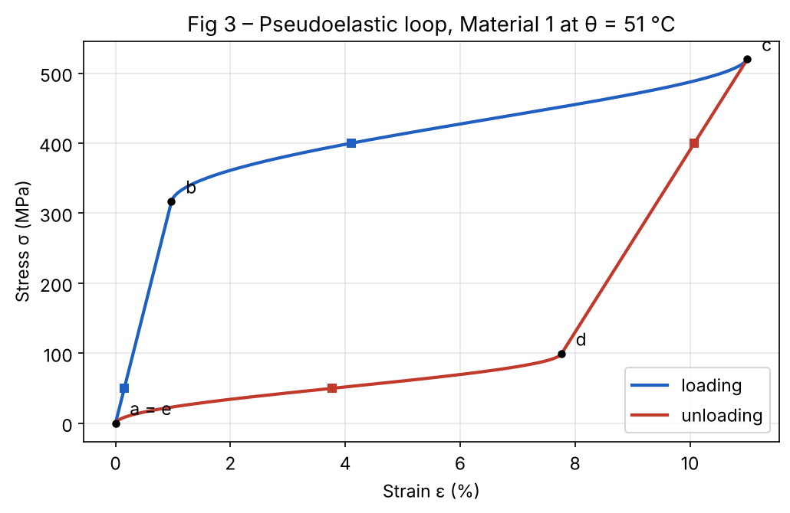
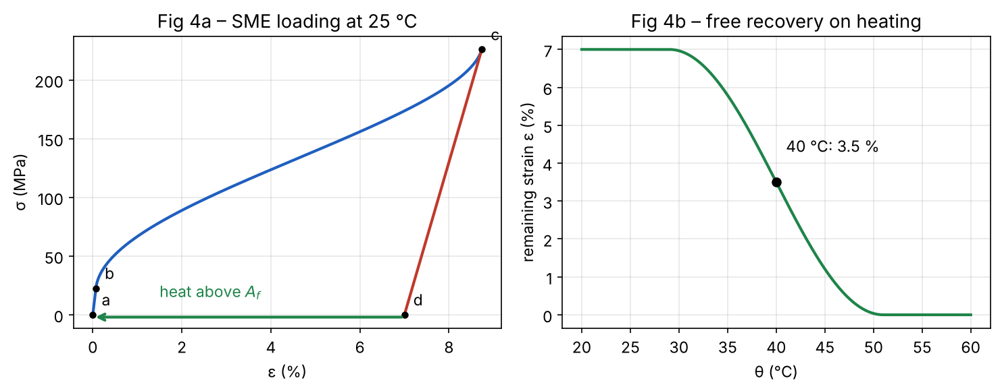
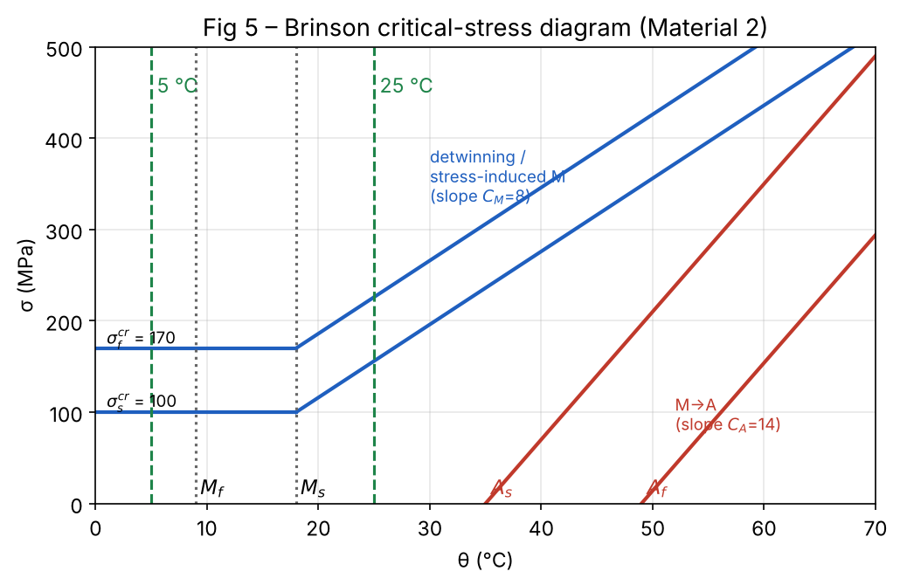
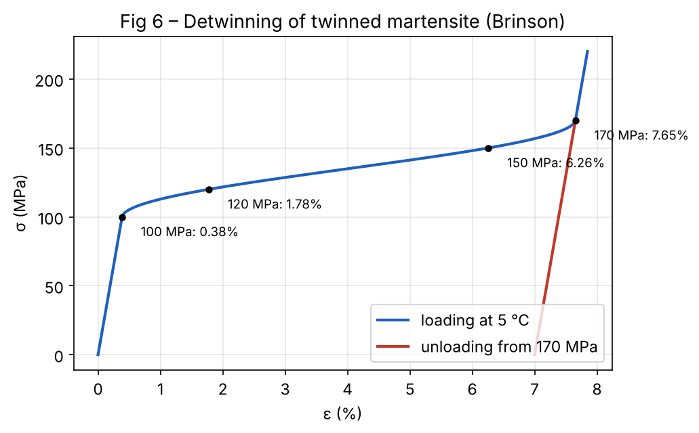
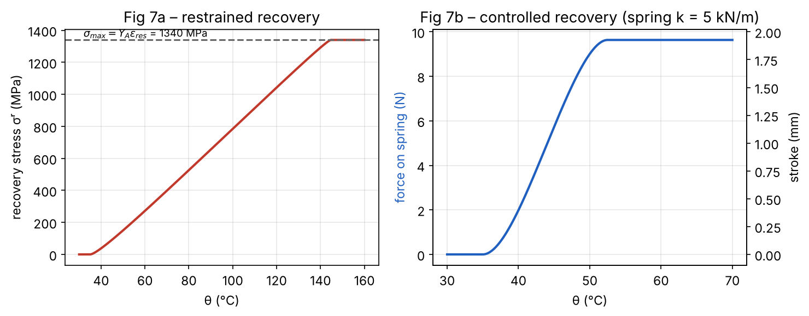
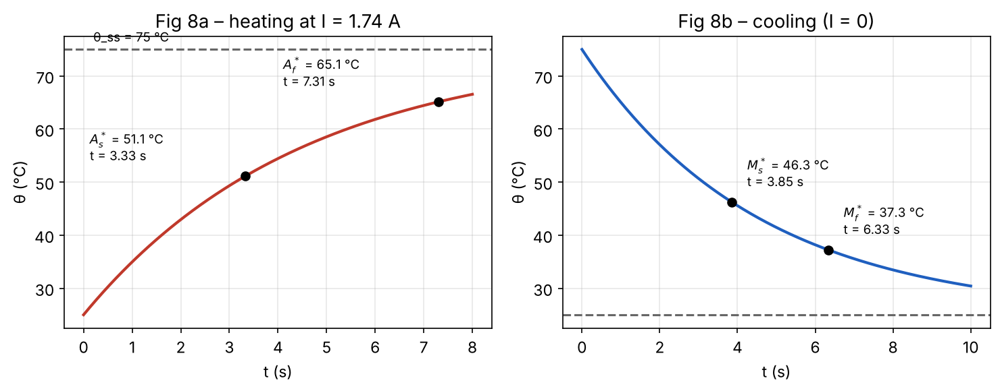

# APL434: Shape Memory Alloys (SMA) – Solved Numerical Problem Bank

This file covers every type of SMA numerical problem from the course (Weeks 11–13): transformation temperatures, kinetic laws, the Liang & Rogers and Brinson constitutive models, the three recovery cases, and Joule-heating actuation. Each problem has a full worked solution, and the figures are in `figures/sma/`.

All answers were computed and checked in Python. The notation follows the lecture notes.

---

## Contents

0. [Formula sheet](#0-formula-sheet)
1. [Material data used in the problems](#1-material-data)
2. [A. Phase diagram and transformation temperatures (Q1–Q3)](#a-phase-diagram-and-transformation-temperatures)
3. [B. Kinetic law: martensite fraction ξ (Q4–Q7)](#b-kinetic-law-martensite-fraction-ξ)
4. [C. Liang & Rogers stress–strain problems (Q8–Q11)](#c-liang--rogers-stressstrain-problems)
5. [D. Brinson model problems (Q12–Q14)](#d-brinson-model-problems)
6. [E. Recovery problems: free, restrained, controlled (Q15–Q16)](#e-recovery-problems)
7. [F. Electrical (Joule) actuation (Q17–Q18)](#f-electrical-joule-actuation)
8. [G. Actuator design (Q19)](#g-actuator-design)
9. [Exam strategy: how to attack any SMA question](#exam-strategy)

---

## 0. Formula sheet

**Transformation temperatures (zero stress):** $M_f < M_s < A_s < A_f$

**Stress-shifted temperatures** (the lines in the phase diagram):

$$M_s^* = M_s + \frac{\sigma}{C_M},\quad M_f^* = M_f + \frac{\sigma}{C_M},\quad A_s^* = A_s + \frac{\sigma}{C_A},\quad A_f^* = A_f + \frac{\sigma}{C_A}$$

Equivalently, at temperature θ the critical stresses are $\sigma = C_M(\theta - M_s)$ (forward start), $C_M(\theta-M_f)$ (forward finish), $C_A(\theta-A_s)$ (reverse start) and $C_A(\theta-A_f)$ (reverse finish).

**Liang & Rogers kinetic law** with $a_M = \dfrac{\pi}{M_s - M_f}$ and $a_A = \dfrac{\pi}{A_f - A_s}$:

| Transformation | Formula | Valid range |
|---|---|---|
| A → M (cooling/loading) | $\xi = \tfrac12\{\cos[a_M(\theta - M_f - \sigma/C_M)] + 1\}$ | $M_f^* < \theta < M_s^*$ |
| M → A (heating/unloading) | $\xi = \tfrac12\{\cos[a_A(\theta - A_s - \sigma/C_A)] + 1\}$ | $A_s^* < \theta < A_f^*$ |
| A → M, starting from $\xi_0 \ne 0$ | $\xi = \tfrac{1-\xi_0}{2}\cos[a_M(\theta - M_f^*)] + \tfrac{1+\xi_0}{2}$ | |
| M → A, starting from $\xi_0 \ne 1$ | $\xi = \tfrac{\xi_0}{2}\{\cos[a_A(\theta - A_s^*)] + 1\}$ | |

**Liang & Rogers constitutive law:**

$$\sigma - \sigma_0 = Y(\xi)\,\varepsilon - Y(\xi_0)\,\varepsilon_0 + \Omega\,\xi - \Omega\,\xi_0,\qquad \Omega = -\varepsilon_L Y$$

The most useful form is $\boxed{\varepsilon = \dfrac{\sigma}{Y(\xi)} + \varepsilon_L\,\xi}$, with $Y(\xi) = Y_A + \xi\,(Y_M - Y_A)$.

**Brinson model:** $\xi = \xi_S + \xi_T$, and $\boxed{\sigma = Y(\xi)\,(\varepsilon - \varepsilon_L\,\xi_S)}$, so $\varepsilon = \dfrac{\sigma}{Y(\xi)} + \varepsilon_L\xi_S$.

- Case I, $\theta < M_s$, $\sigma_s^{cr} < \sigma < \sigma_f^{cr}$:
  $\xi_S = \tfrac{1-\xi_{S0}}{2}\cos\!\left[\tfrac{\pi}{\sigma_s^{cr}-\sigma_f^{cr}}(\sigma - \sigma_f^{cr})\right] + \tfrac{1+\xi_{S0}}{2}$, and $\xi_T = \xi_{T0} - \tfrac{\xi_{T0}}{1-\xi_{S0}}(\xi_S - \xi_{S0})$
- Case II, $\theta > M_s$: the same formula, with $\sigma$ replaced by $\sigma - C_M(\theta - M_s)$
- Case III, $\theta > A_s$ (reverse): $\xi = \tfrac{\xi_0}{2}\{\cos[a_A(\theta - A_s - \sigma/C_A)] + 1\}$, with $\xi_S = \tfrac{\xi_{S0}}{\xi_0}\xi$ and $\xi_T = \tfrac{\xi_{T0}}{\xi_0}\xi$

**Recovery:**
- Residual strain after unloading: $\varepsilon_{res} = \varepsilon_L\,\xi_{S}$
- Free recovery: $\varepsilon^r = \dfrac{\varepsilon_{res}}{2}\{\cos[a_A(\theta - A_s)] + 1\}$
- Restrained recovery: $\sigma^r = Y(\xi)(\varepsilon_{res} - \varepsilon_L\xi_S)$, solved together with the kinetic law (implicit), with $\sigma^r_{max} = Y_A\,\varepsilon_{res}$
- Controlled recovery against a spring: $\left[1 + \dfrac{A\,Y(\xi)}{kL}\right]\sigma^r = -\varepsilon_L\,Y(\xi)\,(\xi_S - \xi_{S0})$

**Joule heating** of a wire:

$$\rho A c_p\frac{d\theta}{dt} = I^2R - h_cA_c(\theta - \theta_\infty)$$

- Time constant: $\tau = \dfrac{\rho\,A\,c_p}{h_c\,A_c}$, which equals $\dfrac{\rho\,d\,c_p}{4h_c}$ for a round wire
- Steady state: $\theta_{ss} = \theta_\infty + \dfrac{I^2R}{h_cA_c}$
- Time to heat to $\theta_d$: $t_d = -\tau\ln\!\left(\dfrac{\theta_{ss}-\theta_d}{\theta_{ss}-\theta_\infty}\right)$
- Time to cool to $\theta_d$: $t_d = -\tau\ln\!\left(\dfrac{\theta_d-\theta_\infty}{\theta_0-\theta_\infty}\right)$
- Resistance: $R = \rho_e L/A$; lateral area: $A_c = \pi d L$

---

## 1. Material data

**Material 1** (NiTi wire, lecture Week 12, Example 1; Liang & Rogers)

| $M_f$ | $M_s$ | $A_s$ | $A_f$ | $C_M$ | $C_A$ | $\varepsilon_L$ | $Y_A$ | $Y_M$ |
|---|---|---|---|---|---|---|---|---|
| 5 °C | 23 °C | 29 °C | 51 °C | 11.3 MPa/°C | 4.5 MPa/°C | 0.07 | 32.5 GPa | 13 GPa |

From these: $a_M = \pi/18 = 0.1745$ /°C and $a_A = \pi/22 = 0.1428$ /°C.

**Material 2** (lecture Week 12, Example 2 and Week 13; Brinson)

| $M_f$ | $M_s$ | $A_s$ | $A_f$ | $C_M$ | $C_A$ | $\sigma_s^{cr}$ | $\sigma_f^{cr}$ | $\varepsilon_L$ | $Y_A$ | $Y_M$ |
|---|---|---|---|---|---|---|---|---|---|---|
| 9 °C | 18 °C | 35 °C | 49 °C | 8 MPa/°C | 14 MPa/°C | 100 MPa | 170 MPa | 0.07 | 67 GPa | 26 GPa |

From these: $a_A = \pi/14 = 0.2244$ /°C.

**Wire data** (Week 13): length L = 10 cm, diameter d = 0.5 mm, density ρ = 6450 kg/m³, $c_p$ = 0.2 kcal/kg°C = 837.4 J/kg°C, $h_c$ = 150 W/m²°C, $\theta_\infty$ = 25 °C, resistivity $\rho_e$ = 76 μΩ·cm = 7.6×10⁻⁷ Ω·m.

---

## A. Phase diagram and transformation temperatures

### Q1. Shifted transformation temperatures
*Material 1 carries a constant stress of 100 MPa. Find the transformation temperatures under this stress.*

**Solution.** Each temperature moves up by σ/C:

| Quantity | Calculation | Result |
|---|---|---|
| $M_s^*$ | 23 + 100/11.3 | **31.85 °C** |
| $M_f^*$ | 5 + 100/11.3 | **13.85 °C** |
| $A_s^*$ | 29 + 100/4.5 | **51.22 °C** |
| $A_f^*$ | 51 + 100/4.5 | **73.22 °C** |

**What this means:** stress makes martensite more stable, so you must heat further (to 73 °C instead of 51 °C) to fully recover austenite. This is why an SMA actuator lifting a load needs a higher temperature.

### Q2. Critical stresses at a given temperature
*Material 1 is at 40 °C. Find the stresses at which (a) A → M starts and finishes on loading, and (b) M → A starts and finishes on unloading.*

**Solution.**
- (a) Start: $\sigma = C_M(\theta - M_s) = 11.3(40-23) =$ **192.1 MPa**. Finish: $\sigma = C_M(\theta - M_f) = 11.3(40-5) =$ **395.5 MPa**.
- (b) Start: $\sigma = C_A(\theta - A_s) = 4.5(40-29) =$ **49.5 MPa**. Finish: $\sigma = C_A(\theta - A_f) = 4.5(40-51) = -49.5$ MPa.

The finish stress is negative, so the reverse transformation **cannot finish** during unloading to zero stress. This is the "partial pseudoelasticity" case (Q3).

### Q3. Which behaviour will you see?
*Material 1 is loaded until fully martensite and then unloaded to σ = 0 at 0 °C, 25 °C, 40 °C and 60 °C. Describe each response and find the residual strain.*

**Solution.**

| θ | Region | Behaviour | Residual strain |
|---|---|---|---|
| 0 °C | θ < $M_f$, starts as twinned martensite | Detwinning; strain stays after unloading (**SME**) | $\varepsilon_L$ = 7 % |
| 25 °C | $M_s$ < θ < $A_s$, starts as austenite | Stress-induced martensite is stable at σ = 0 (**SME**) | 7 % |
| 40 °C | $A_s$ < θ < $A_f$ | **Partial pseudoelasticity**: reverse starts at 49.5 MPa but can't finish | see below |
| 60 °C | θ > $A_f$ | **Full pseudoelasticity** | 0 |

The 40 °C case: at σ = 0, $\xi = \tfrac12\{\cos[a_A(40-29-0)] + 1\} = \tfrac12\{\cos(\pi/2) + 1\} = 0.5$, so

$$\varepsilon_{res} = \varepsilon_L\,\xi = 0.07 \times 0.5 = \mathbf{3.5\,\%}$$

To remove the remaining 3.5 %, heat above $A_f$ = 51 °C.

---

## B. Kinetic law: martensite fraction ξ

### Q4. ξ at a given temperature (zero stress)
*Material 1, stress-free. Find ξ (a) on cooling from 60 °C to 15 °C, and (b) on heating from 0 °C to 40 °C.*

**Solution.**
- (a) $M_f$ < 15 < $M_s$, so A → M is in progress:
  $$\xi = \tfrac12\{\cos[a_M(15 - 5)] + 1\} = \tfrac12\{\cos(100^\circ) + 1\} = \tfrac12(-0.1736 + 1) = \mathbf{0.413}$$
- (b) $A_s$ < 40 < $A_f$, so M → A is in progress:
  $$\xi = \tfrac12\{\cos[a_A(40 - 29)] + 1\} = \tfrac12\{\cos(90^\circ) + 1\} = \mathbf{0.5}$$

The same temperature range gives a **different ξ on heating vs cooling**. That difference is the thermal hysteresis.

### Q5. Temperature for a given ξ (inverse problem)
*Material 1, stress-free. At what temperature is (a) ξ = 0.5 on cooling, (b) ξ = 0.5 on heating, and (c) ξ = 0.9 on cooling?*

**Solution.** Invert the kinetic law: $\cos[a(\theta - T_0)] = 2\xi - 1$, so $\theta = T_0 + \dfrac{\cos^{-1}(2\xi-1)}{a}$.

- (a) $\theta = 5 + \dfrac{\cos^{-1}(0)}{\pi/18} = 5 + 9 =$ **14 °C** (the midpoint of $M_f$ and $M_s$)
- (b) $\theta = 29 + 11 =$ **40 °C** (the midpoint of $A_s$ and $A_f$)
- (c) $\theta = 5 + \dfrac{\cos^{-1}(0.8)}{0.1745} = 5 + \dfrac{0.6435}{0.1745} =$ **8.69 °C**

**Shortcut:** ξ = 0.5 always occurs at the midpoint of the transformation range.

### Q6. ξ under stress
*Material 1 carries 300 MPa and is cooled from above $M_s^*$ to 40 °C. Find ξ.*

**Solution.**
- $M_s^* = 23 + 300/11.3 = 49.55$ °C and $M_f^* = 5 + 300/11.3 = 31.55$ °C.
- 40 °C lies between them, so A → M is in progress:
$$\xi = \tfrac12\{\cos[a_M(40 - 5 - 300/11.3)] + 1\} = \tfrac12\{\cos[0.1745 \times 8.45] + 1\} = \mathbf{0.548}$$

At zero stress the wire would be fully austenite at 40 °C. The 300 MPa load makes it about 55 % martensite.

### Q7. Temperature to recover a given fraction of strain
*A Material 1 wire has 7 % residual strain (ξ = 1) at room temperature. To what temperature must it be heated (stress-free) to recover 90 % of that strain?*

**Solution.** 90 % recovered means $\xi = 0.1$:
$$\theta = A_s + \frac{\cos^{-1}(2(0.1) - 1)}{a_A} = 29 + \frac{\cos^{-1}(-0.8)}{0.1428} = 29 + \frac{2.498}{0.1428} = \mathbf{46.5\ ^\circ C}$$

---

## C. Liang & Rogers stress–strain problems

### Q8. Transformation coefficient Ω
*Show that Ω = −ε_L Y and evaluate it for Material 1.*

**Solution.**
1. Start fully austenite, at $\sigma_0 = \varepsilon_0 = \xi_0 = 0$.
2. Load, then unload at θ < $A_s$. At point d the material is fully martensite ($\xi = 1$), σ = 0 and the strain is $\varepsilon_L$.
3. Substitute into $\sigma = Y\varepsilon + \Omega\xi$: $0 = Y\varepsilon_L + \Omega(1)$, which gives $\boxed{\Omega = -\varepsilon_L Y}$.
4. Numbers: $\Omega_A = -0.07 \times 32\,500 = -2275$ MPa and $\Omega_M = -0.07 \times 13\,000 = -910$ MPa.

### Q9. Full pseudoelastic loop (lecture Week 12, Example 1)
*Material 1 is loaded isothermally at θ = 51 °C until fully martensite, then unloaded to zero. (a) Find σ and ε at points a, b, c, d and e. (b) Find the strain at 400 MPa and at 50 MPa on both loading and unloading.*

**Solution (a).**

| Point | What happens | Stress | Strain |
|---|---|---|---|
| a | start, ξ = 0 | 0 | 0 |
| b | A → M starts, $\theta = M_s^*$ | $C_M(51-23) =$ **316.4 MPa** | $316.4/32\,500 =$ **0.97 %** |
| c | A → M finished, $\theta = M_f^*$ | $C_M(51-5) =$ **519.8 MPa** | $\dfrac{519.8}{13\,000} + 0.07 =$ **11.0 %** |
| d | M → A starts on unloading, $\theta = A_s^*$ | $C_A(51-29) =$ **99 MPa** | $\dfrac{99}{13\,000} + 0.07 =$ **7.76 %** |
| e | M → A finished, $\theta = A_f^*$ | $C_A(51-51) =$ **0** | **0** (back to point a) |

Between b and c, Y changes from $Y_A$ to $Y_M$. Between c and d the material is elastic martensite ($Y_M$).

**Solution (b).** The steps for any stress level are always the same:
1. Find ξ from the kinetic law.
2. Find $Y(\xi)$.
3. Compute $\varepsilon = \sigma/Y(\xi) + \varepsilon_L\xi$.

| Case | ξ | Y(ξ) | Strain |
|---|---|---|---|
| 400 MPa, loading | $\tfrac12\{\cos[a_M(51-5-400/11.3)]+1\} = \tfrac12\{\cos(1.850)+1\} =$ **0.362** | 32.5 − 19.5(0.362) = **25.44 GPa** | $\dfrac{400}{25\,440} + 0.07(0.362) =$ **4.11 %** |
| 400 MPa, unloading | 1 (still fully M, since 400 > 99) | $Y_M$ = 13 GPa | $\dfrac{400}{13\,000} + 0.07 =$ **10.08 %** |
| 50 MPa, loading | 0 (below 316.4) | $Y_A$ | $\dfrac{50}{32\,500} =$ **0.15 %** |
| 50 MPa, unloading | $\tfrac12\{\cos[a_A(51-29-50/4.5)]+1\} = \tfrac12\{\cos(1.555)+1\} =$ **0.508** | 32.5 − 19.5(0.508) = **22.60 GPa** | $\dfrac{50}{22\,600} + 0.07(0.508) =$ **3.78 %** |

**Exam tip:** at the same stress, the strain differs between loading and unloading. Always say which branch you are on.

### Q10. Shape memory effect at 25 °C
*Material 1 is loaded at θ = 25 °C (between $M_s$ and $A_s$) until fully martensite, unloaded, then heated stress-free. (a) Find the stress and strain at b, c and d. (b) Find the strain at 100 MPa during loading. (c) Find the strain left when the wire is heated to 40 °C.*

**Solution (a).**
- b: $\sigma_b = C_M(25-23) =$ **22.6 MPa**, $\varepsilon_b = 22.6/32\,500 =$ **0.070 %**
- c: $\sigma_c = C_M(25-5) =$ **226 MPa**, $\varepsilon_c = 226/13\,000 + 0.07 =$ **8.74 %**
- d: on unloading, the reverse transformation would need $\sigma = C_A(25-29) = -18$ MPa < 0, so it never starts. ξ stays at 1 and $\varepsilon_d = \varepsilon_L =$ **7 %**.

**Solution (b).**
$$\xi = \tfrac12\{\cos[a_M(25-5-100/11.3)]+1\} = 0.317,\quad Y = 26.32\text{ GPa},\quad \varepsilon = \frac{100}{26\,320} + 0.07(0.317) = \mathbf{2.60\,\%}$$

**Solution (c).** Free recovery: $\xi = \tfrac12\{\cos[a_A(40-29)]+1\} = 0.5$, so $\varepsilon = 0.07 \times 0.5 =$ **3.5 %**. Heating above 51 °C recovers the strain fully.

### Q11. Energy dissipated per cycle
*Estimate the energy dissipated per unit volume in the pseudoelastic cycle of Q9.*

**Solution.** The dissipated energy is the area enclosed by the loop.
- **Quick estimate:** treat the loop as a parallelogram of height (average upper plateau − average lower plateau) and width $\varepsilon_L$:
$$\Delta W \approx \left(\frac{316.4+519.8}{2} - \frac{99+0}{2}\right)\times 0.07 = (418.1 - 49.5)(0.07) \approx \mathbf{25.8\ MJ/m^3}$$
- **Exact numerical integration** of the Fig. 3 curves gives **30.2 MJ/m³** (1 MPa × strain = 1 MJ/m³).

This dissipated energy is what makes pseudoelastic SMAs useful as **dampers**.

---

## D. Brinson model problems

### Q12. Detwinning of twinned martensite (lecture Week 12, Example 2, extended)
*Material 2 starts at θ₀ = 5 °C (below $M_f$), fully temperature-induced martensite: $\xi_{T0} = 1$, $\xi_{S0} = 0$, $\sigma_0 = \varepsilon_0 = 0$. Find ε, $\xi_S$ and $\xi_T$ at σ = 100, 120, 150 and 170 MPa. Then find the residual strain after unloading from 170 MPa and from 150 MPa.*

**Solution.** Total ξ = 1 throughout (the material is always 100 % martensite; only the variant changes), so $Y = Y_M$ = 26 GPa.

The Case I formula with $\xi_{S0} = 0$ gives

$$\xi_S = \tfrac12\cos\!\left[\frac{\pi}{100-170}(\sigma - 170)\right] + \tfrac12,\qquad \xi_T = 1 - \xi_S,\qquad \varepsilon = \frac{\sigma}{Y_M} + \varepsilon_L\xi_S$$

| σ (MPa) | Cosine argument | $\xi_S$ | $\xi_T$ | ε |
|---|---|---|---|---|
| 100 | π (below $\sigma_s^{cr}$) | 0 | 1 | 100/26 000 = **0.385 %** |
| 120 | (−π/70)(−50) = 2.244 rad | **0.188** | 0.812 | 0.4615 % + 1.318 % = **1.78 %** |
| 150 | (−π/70)(−20) = 0.898 rad | **0.812** | 0.188 | 0.577 % + 5.68 % = **6.26 %** |
| 170 | 0 | **1** | 0 | 0.654 % + 7 % = **7.65 %** |

Residual strain after unloading (ξ_S doesn't change on elastic unloading):
- from 170 MPa: $\varepsilon_{res} = \varepsilon_L\xi_S = 0.07 \times 1 =$ **7 %**
- from 150 MPa: $\varepsilon_{res} = 0.07 \times 0.812 =$ **5.68 %**

### Q13. Heating a detwinned wire (Case III)
*The wire from Q12, unloaded from 170 MPa ($\xi_{S0} = 1$, $\xi_{T0} = 0$, ε = 7 %), is heated stress-free to 40 °C. Find the remaining strain.*

**Solution.** θ = 40 °C lies between $A_s$ = 35 °C and $A_f$ = 49 °C, so M → A is in progress:
$$\xi = \frac{\xi_0}{2}\{\cos[a_A(40-35)]+1\} = \tfrac12\{\cos(5\pi/14)+1\} = \tfrac12(0.4339+1) = 0.717$$
$$\xi_S = \frac{\xi_{S0}}{\xi_0}\,\xi = 0.717,\qquad \varepsilon = \varepsilon_L\xi_S = 0.07 \times 0.717 = \mathbf{5.02\,\%}$$

About 28 % of the strain has been recovered at 40 °C. All of it is recovered at 49 °C.

### Q14. Stress-induced martensite above M_s (Case II)
*Material 2 is fully austenite at θ = 25 °C. (a) At what stresses does A → M start and finish? (b) Find the strain at σ = 190 MPa.*

**Solution (a).** Above $M_s$ the critical stresses rise along the $C_M$ line:
- Start: $\sigma_s^{cr} + C_M(\theta - M_s) = 100 + 8(7) =$ **156 MPa**
- Finish: $\sigma_f^{cr} + C_M(\theta - M_s) = 170 + 56 =$ **226 MPa**

**Solution (b).** Use Case II with $\xi_{S0} = 0$:
$$\xi_S = \tfrac12\cos\!\left\{\frac{\pi}{100-170}[190 - 170 - 56]\right\} + \tfrac12 = \tfrac12\cos(1.616) + \tfrac12 = \mathbf{0.478}$$

Starting from austenite, $\xi_T$ = 0, so total ξ = 0.478. Then:
$$Y = 67 - 41(0.478) = 47.42\text{ GPa},\qquad \varepsilon = \frac{190}{47\,420} + 0.07(0.478) = 0.40\,\% + 3.34\,\% = \mathbf{3.74\,\%}$$

---

## E. Recovery problems

Setup used in Q15–Q16 (Material 2): the wire was prestrained and unloaded at low temperature, leaving $\varepsilon_{res}$ = 2 %. So $\xi_{S0} = \varepsilon_{res}/\varepsilon_L = 0.02/0.07 = 0.2857$, $\xi_{T0} = 0.7143$ and $\xi_0 = 1$.

### Q15. Restrained recovery
*Both ends of the wire are fixed, so the strain stays at 2 %, and the wire is heated. (a) What is the maximum recovery stress? (b) Find the recovery stress at 60 °C. (c) At what temperature is the maximum reached?*

**Solution (a).** At full recovery, ξ = 0 and Y = $Y_A$:
$$\sigma^r_{max} = Y_A\,\varepsilon_{res} = 67\,000 \times 0.02 = \mathbf{1340\ MPa}$$

(This is far above a real wire's strength. In practice the wire yields first, which is why real actuators limit the prestrain.)

**Solution (b).** The equations are **implicit**, because ξ depends on σ:
$$\sigma = Y(\xi)\,(\varepsilon_{res} - \varepsilon_L\xi_S),\qquad \xi = \tfrac12\{\cos[a_A(\theta - A_s - \sigma/C_A)]+1\},\qquad \xi_S = 0.2857\,\xi$$

Solve by iteration: guess σ, compute ξ, recompute σ, and repeat. At θ = 60 °C this converges to:
- σ = **272 MPa**
- check: $\theta - A_s - \sigma/C_A = 60 - 35 - 19.45 = 5.55$, giving ξ = ½{cos(1.246) + 1} = **0.659**
- $\xi_S = 0.188$, Y = 67 − 41(0.659) = 39.96 GPa
- σ = 39 960 × (0.02 − 0.07 × 0.188) = **272 MPa** ✓

| θ (°C) | 35 | 40 | 50 | 60 | 80 | 100 | 120 | 140 |
|---|---|---|---|---|---|---|---|---|
| σʳ (MPa) | 0 | 37.7 | 149.8 | 272.2 | 526.4 | 784.8 | 1042.9 | 1292.6 |
| ξ | 1 | 0.934 | 0.785 | 0.659 | 0.455 | 0.289 | 0.146 | 0.022 |

**Solution (c).** The transformation finishes when $\theta - \sigma/C_A = A_f$, so $\theta = 49 + 1340/14 =$ **144.7 °C**. The stress needed to block the recovery pushes the transformation to much higher temperatures.

### Q16. Controlled recovery against a spring
*The same wire (L = 10 cm, d = 0.5 mm, so A = 1.963×10⁻⁷ m²) is connected to a linear spring k = 5000 N/m that is unstretched at the start. Find the force and stroke when the wire is heated to 45 °C and to 60 °C.*

**Solution.** Combine spring equilibrium $\sigma A = kL(\varepsilon_{res} - \varepsilon)$ with $\sigma = Y(\xi)(\varepsilon - \varepsilon_L\xi_S)$:
$$\left[1 + \frac{A\,Y(\xi)}{kL}\right]\sigma = -\varepsilon_L Y(\xi)(\xi_S - \xi_{S0})$$

With austenite, $AY_A/(kL) = 26.31$: the wire is about 26 times stiffer than the spring.

| θ | σ (MPa) | ξ | Force F = σA | Stroke = F/k |
|---|---|---|---|---|
| 45 °C | 29.2 | 0.398 | **5.73 N** | **1.15 mm** |
| ≥ 52 °C (fully A) | 49.07 | 0 | **9.63 N** | **1.93 mm** |

Check of the final state: $\sigma = \dfrac{\varepsilon_L Y_A\,\xi_{S0}}{1 + 26.31} = \dfrac{0.02 \times 67\,000}{27.31} = 49.07$ MPa.

**Interpretation:**
- A **soft spring** gives a large stroke but a small force, approaching free recovery.
- A **stiff spring** gives a large force but a small stroke, approaching restrained recovery.

This is the same trade-off as load matching for a piezo stack.

---

## F. Electrical (Joule) actuation

### Q17. SMA wire actuator lifting a weight (lecture Week 13 example, fully solved)
*A 10 cm NiTi wire with d = 0.5 mm (Material 2 and the wire data above) at $\theta_0 = \theta_\infty$ = 25 °C is preloaded by a dead weight W.*
- *(a) Find the W needed to cause full A → M.*
- *(b) Find the current for a steady-state temperature of 75 °C.*
- *(c) Find the time at which M → A starts and finishes.*
- *(d) After the current is switched off, how long until the wire is fully martensite again? What is the maximum cycling frequency?*
- *(e) Find the stroke and the work done per cycle.*

**Solution (a).** At 25 °C (> $M_s$), full transformation needs $\sigma = \sigma_f^{cr} + C_M(\theta - M_s) = 170 + 8(25-18) =$ **226 MPa**.
$$A = \frac{\pi(0.5\times10^{-3})^2}{4} = 1.963\times10^{-7}\ \text{m}^2,\qquad W = \sigma A = 226\times10^6 \times 1.963\times10^{-7} = \mathbf{44.4\ N}$$

**Solution (b).**
$$R = \frac{\rho_e L}{A} = \frac{7.6\times10^{-7}\times 0.1}{1.963\times10^{-7}} = 0.387\ \Omega,\qquad A_c = \pi d L = 1.571\times10^{-4}\ \text{m}^2$$
$$\theta_{ss} - \theta_\infty = \frac{I^2R}{h_cA_c} \;\Rightarrow\; I = \sqrt{\frac{150 \times 1.571\times10^{-4} \times 50}{0.387}} = \mathbf{1.74\ A}$$

(The lecture notes write "1.1 A (?)", with a question mark. The answer depends on the resistivity you assume; with $\rho_e$ = 76 μΩ·cm, the result is 1.74 A.)

**Solution (c).**
- Time constant: $\tau = \dfrac{\rho\,d\,c_p}{4h_c} = \dfrac{6450 \times 0.5\times10^{-3} \times 837.4}{4 \times 150} =$ **4.50 s**
- The weight keeps σ = 226 MPa, so: $A_s^* = 35 + 226/14 = 51.14$ °C and $A_f^* = 49 + 226/14 = 65.14$ °C
- Start: $t = -4.50\ln\dfrac{75-51.14}{75-25} =$ **3.33 s**
- Finish: $t = -4.50\ln\dfrac{75-65.14}{50} =$ **7.31 s**
- So the transformation itself takes about **3.98 s**.

**Solution (d).**
- $M_s^* = 18 + 226/8 = 46.25$ °C and $M_f^* = 9 + 226/8 = 37.25$ °C
- Cooling from 75 °C: $t = -\tau\ln\dfrac{\theta_d - 25}{75-25}$
  - to $M_s^*$: **3.85 s**
  - to $M_f^*$: **6.33 s**
- One full cycle takes about 7.31 + 6.33 ≈ 13.6 s, so the maximum frequency is about **0.073 Hz**.

Cooling is the bottleneck. That's why SMA actuators are slow.

**Solution (e).** The strain changes from fully martensite under load to fully austenite under load:
$$\Delta\varepsilon = \left(\varepsilon_L + \frac{\sigma}{Y_M}\right) - \frac{\sigma}{Y_A} = 0.07 + 0.00869 - 0.00337 = 0.0753$$
- Stroke = 0.0753 × 100 mm = **7.53 mm**
- Work = W × stroke = 44.4 × 7.53×10⁻³ = **0.334 J per cycle**

### Q18. Current for a required actuation time
*For the Q17 wire, what current makes the transformation finish (reach $A_f^*$ = 65.14 °C) in 3 s?*

**Solution.** Solve $\theta(t) = \theta_\infty + (\theta_{ss}-\theta_\infty)(1-e^{-t/\tau})$ for $\theta_{ss}$:
$$\theta_{ss} = 25 + \frac{65.14 - 25}{1 - e^{-3/4.50}} = 25 + \frac{40.14}{0.4866} = 107.5\ ^\circ\text{C}$$
$$I = \sqrt{\frac{h_cA_c(\theta_{ss}-\theta_\infty)}{R}} = \sqrt{\frac{150 \times 1.571\times10^{-4} \times 82.5}{0.387}} = \mathbf{2.24\ A}$$

Faster heating needs more current, but the steady-state temperature then rises well above what is needed. Be careful not to overheat the wire.

---

## G. Actuator design

### Q19. Sizing an SMA wire
*An SMA wire must lift 20 N through 5 mm. For fatigue life, limit the stress to 200 MPa and the usable strain to 4 %. Find the wire diameter and length.*

**Solution.**
- Area: $A = F/\sigma = 20/(200\times10^6) = 1.0\times10^{-7}$ m², so $d = \sqrt{4A/\pi} =$ **0.357 mm**. Choose the next standard size, 0.38 mm.
- Length: $L = \text{stroke}/\varepsilon = 5/0.04 =$ **125 mm**

Then check that the loaded transformation temperatures ($A_f^*$ at 200 MPa) can be reached with the available current (as in Q17).

---

## Exam strategy

How to attack any SMA question:

1. **Draw the phase diagram** (Fig 1 or Fig 5) and mark your temperature θ.
   - θ < $M_f$: twinned martensite, so the answer is detwinning or SME (Brinson Case I).
   - $M_s$ < θ < $A_s$: SME. The strain stays after unloading.
   - $A_s$ < θ < $A_f$: partial pseudoelasticity. Some strain stays.
   - θ > $A_f$: full pseudoelasticity.
2. **Find the critical stresses** at your θ using the four lines: $C_M(\theta - M_s)$, $C_M(\theta - M_f)$, $C_A(\theta - A_s)$ and $C_A(\theta - A_f)$.
3. **Decide which branch you are on** (loading or unloading) and whether a transformation is active. If none is active, ξ stays constant.
4. **Compute ξ** from the kinetic law. Remember that the argument of the cosine contains σ/C.
5. **Compute $Y(\xi)$**, then the strain: $\varepsilon = \sigma/Y + \varepsilon_L\xi$ (Liang & Rogers) or $\varepsilon = \sigma/Y + \varepsilon_L\xi_S$ (Brinson).
6. **For recovery problems:**
   - free: strain = $\varepsilon_L\xi$
   - restrained: solve the implicit equation by iteration
   - spring: use the controlled-recovery formula
7. **For Joule heating:** find τ, then $\theta_{ss}$, then the times using the ln formula. Always use the stress-shifted temperatures ($A_s^*$, $A_f^*$, $M_s^*$, $M_f^*$).

**Common mistakes:**
- using $A_s$ instead of $A_s^*$ when the wire carries a load
- forgetting the cosine argument is in **radians**
- using $Y_A$ where $Y(\xi)$ or $Y_M$ is needed
- mixing up MPa and GPa: keep stresses in MPa and moduli in MPa (13 GPa = 13 000 MPa)
- in Brinson problems, using total ξ in the strain term instead of $\xi_S$
